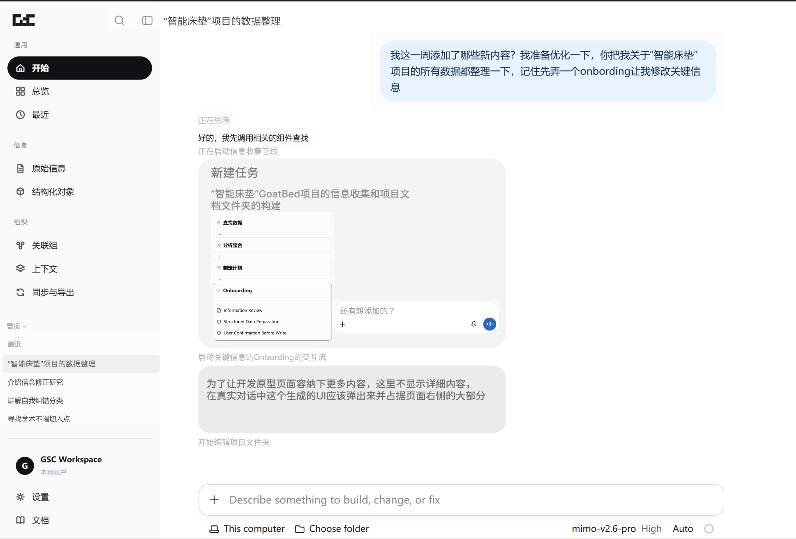
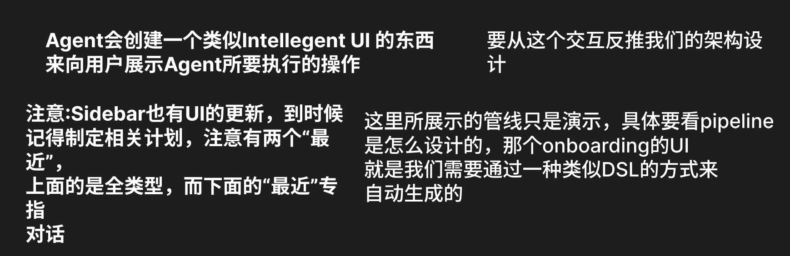

# GSC_CHAT_PLAN.md — G7「GSC 对话」分步执行计划 v2（技术版）

Status: `PROPOSED` — 2026-11-25（v2 加密技术规格）。蓝本：`GSC_CHAT_DESIGN.md` v2。
架构立场（讨论结论，随 Step 3 记 D-110）：**不搭 agent framework**——搭「LLM 任务层 +
薄编排器」，可选 bounded tool-loop 插座；理由见 §1.0。任务卡七项见设计文档 §9。

## 0. 目标（具体场景，跑通即验收）

对话页发「把智能床垫项目的数据整理一下，先弄 onboarding 让我改关键信息」→ Agent 宣言 →
任务卡弹出（查找数据→分析融合→撰写计划→Onboarding 管线可见）→ 卡内「还有想添加的？」
补「再加一步导出 PDF」→ stage 追加 → 推进到 Onboarding → **右侧 Drawer 弹 DSL 面**
（review 改关键信息→collect 补输入→confirm 写入）→ 提案落地 → 底部「最近」回看对话。

## 0.5 视觉规划（创始人原型，一切 UI 以此为准）

### 目标形态总图


- **消息流**：用户气泡（指令+引用夹 This computer/Choose folder + 模型档 mimo·High·Auto）→
  灰色播报（「正在思考」「正在启动信息收集管线」）→ Agent 文本宣言 → **任务卡**（灰底大卡，
  「新建任务」+ 语义标题）。
- **任务卡内**：管线列表小卡（01 查找数据 / 02 分析融合 / 03 撰写计划 / 04 Onboarding 选中态
  绿边）→ 展开步骤（Information Review / Structured Data Preparation / User Confirmation
  Before Write）→ 右侧卡内输入「还有想添加的？」（+插入/麦克风/蓝色发送钮）。
- **onboarding 面**：原型以灰块占位（「真实对话中这个生成的 UI 应该弹出来并占据页面右侧的
  大部分」）→ V2 落为右侧 Drawer ≈ 60-70% 宽。
- **侧栏**：通用·信息·组织·同步与导出·置顶v·**最近（对话）**·footer——已落地（D-109）。

### 批注图（交互与架构要求）


四条批注 + 原型内嵌一条 → 设计承诺对照见 GSC_CHAT_DESIGN.md §0。

### 分阶段视觉验收对照

| 阶段 | 对照原型区域 | 视觉验收点 |
|---|---|---|
| V1 Step 5 | 任务卡灰卡 + 管线小卡列（01–04）+ 卡内输入 | 结构/序号/展开/状态色对齐原型；PATCH 即时增卡 |
| V2 Step 7 | Onboarding 三步（Review/Preparation/Confirmation） | 右侧 Drawer ≈60-70% 宽；三段交互齐全 |
| V3 Step 9 | 侧栏双「最近」+ 置顶 | 对齐 sidebar-two-recents.png（已验）；对话行 awaiting_user 黄点 |

## 1. 核心技术决策

### 1.0 架构形态：LLM 任务层 + 薄编排器（不搭框架）
原型 UX 契约=「先展示要执行的操作，可改，确认后写」→ 执行必须**计划内**，与涌现式
agent（think-act-observe 循环）形状相反。分层：
1. **LLM 任务层**（扩 `chatComplete`）：结构化输出 + 校验 + 修复重试 + 回退（§1.2）。
2. **薄编排器**：stage 状态机 + 四执行语义 + 停点/恢复（§1.1）。
3. **可选插座**：stage 内 bounded tool-loop（工具白名单+步数上限；V1 不实现，
   只留 `StageExecutor` 接口位）。

### 1.1 Stage 状态机（转移表；非法迁移全拒）
```
pending ──start──▶ running ──engine_done──▶ done
                      │──needs_user──▶ awaiting_user ──user_input──▶ running
                      │──error(attempts<3)──▶ running（指数退避 1s/4s/10s）
                      └──error(fatal)──▶ failed
awaiting_user ──cancel──▶ failed
```
- 存储：`task_stages(status, attempts, detail)`；每次迁移 append `events` 行（审计线）。
- `needs_user` 判定：stage.kind=confirm（常态）或 engine 返回 NEED_INPUT。
- 恢复入口：`PATCH /api/tasks/:id`（卡内 PATCH）与 `POST /api/tasks/:id/advance`。
- runner **不驻留**：awaiting_user 后退出，恢复由 API 调用重新驱动（无轮询进程）。

### 1.2 LLM 任务层契约 `structuredCall<T>`
```
structuredCall(config, schemaHint, messages, { repair: 1, guard })
  → chatComplete → extractJson → guard（id 白名单/字段校验）
  → 失败且 repair>0：校验错误回喂重试 1 次
  → 仍失败：抛 PlanError → 调用方走 fallback
```
- 幻觉守卫沿用现状（proposer/organizer 的 knownIds 模式）。
- 所有 LLM 产物**只进提案/计划层，不直写**（D-042 不变式）。

### 1.3 计划生成契约（指令 → 任务卡）
LLM 输出 JSON：`{title, goal, stages:[{kind, name, steps[]}]}` —
约束：kind∈{collect,synthesize,compose,confirm} · stages≤12 · steps≤8/段 · name≤40字。
**fallback**：解析失败 → 默认四段管线（collect→synthesize→compose→confirm）+ 原文做 goal
（不静默失败，note 块明示「使用默认管线」）。

### 1.4 卡内 PATCH 契约（「还有想添加的？」→ 结构化算子）
```
ops: [{op:"add_stage", after:<ref>, kind, name, steps[]}]
   | [{op:"update_stage", target:<ref>, name?, steps?}]
   | [{op:"remove_stage", target:<ref>}] | [{op:"move_stage", target, after}]
```
- **纯增（add / 追加 steps）= 即时编排**；**删/移/改 kind = 走提案**。
- 幂等：`(task_id, op_hash)` 唯一（op_hash=sha1(canonical ops)），重放零重复。
- ref 解析：stage id 或流水序号（LLM 产序号更稳，映射表在 orchestrator）。

### 1.5 UI DSL 文法（行式、缩进、LLM 友好）
```
flow "关键信息确认"
  review 项目名 = GoatBed
  review 时间范围 = 2026-01..2026-11
  collect 整理粒度
  choose 排除项: 会议纪要 | 采购单 | 不排除
  reference raw_xxx
  confirm write: meta_tag(project), cluster(智能床垫)
  note 用户确认后写入
```
- **解析器**：按行 tokenize（缩进=嵌套）→ AST（FlowNode[]）→ 四道校验：① 词表白名单
  （collect/review/choose/confirm/note/reference）② 字段类型 ③ reference 存在性
  ④ confirm 动作必须是提案类型。
- **降级**：单行解析失败 → 该行降级 note；整流失败 → 普通表单（不丢用户输入）。
- **安全**：无脚本/样式/网络/任意查询；字段值≤2000 字符；节点≤30；首行可带 `!dsl v1`
  版本标，未知版本整流降级。

### 1.6 并发与一致性
- **每 task 串行 runner**（V1 无 intra-task 并行——状态机简单可推理）。
- **乐观锁**：`tasks.version` 整数列；PATCH/advance 携带 version，失配 → 409 + 返回最新态。
- 幂等：写路由 RouteSpec idem；PATCH 另加 op_hash 双保险。

### 1.7 事件投影与消息块
- **message_blocks = UI 投影源**（append-only）；播报 note 块在状态迁移处由 orchestrator
  插入（「正在启动信息收集管线」「启动 Onboarding 交互流」）。
- **events 表 = 审计线**；对账不变式：stage 迁移必留 events 行。
- 回放=按 created_at 重排 message_blocks；不存快照（V3 若需再议）。

## 2. 步骤（十步三阶段，含技术要点）

### Step 0 · 边界落账
DESIGN_BOUNDARIES conversations 行拆分 · DECISION_LOG（D-109 顺记）· GOALS G7 状态。
**验**：三处文档一致。

### Step 1 · 数据层 0016_chat_workspace.sql
```sql
-- 在 0015 conversations/messages 之上补：
ALTER TABLE conversations ADD COLUMN version INTEGER NOT NULL DEFAULT 1;
CREATE TABLE message_blocks(id, message_id, kind, ord INTEGER, ref_id, content);
  -- kind∈text|operation|flow|reference|note；UNIQUE(message_id, ord)
CREATE TABLE tasks(id, message_id, title, goal, status, version INTEGER);
CREATE TABLE task_stages(id, task_id, kind, name, ord, status, attempts INTEGER,
  steps TEXT, detail TEXT);   -- UNIQUE(task_id, ord)
CREATE TABLE uiflows(id, task_id, stage_id, kind, dsl_text, status);
```
- stage kind/status CHECK 枚举 · **ord 稀疏**（间隔 1024，插入免重排）。
- steps=JSON 数组字符串（仅步骤名，非记录系统）。
**验**：migrationSql 全绿 + vitest（CHECK 拒非法枚举 / ord 稀疏插入）。

### Step 2 · 仓储 server/repo/chat.ts（扩展）
- `patchTask(db, taskId, ops[], version)`：op_hash 幂等 → 纯增即时 / 删移改置提案（§1.4）。
- `transitionStage(db, stageId, to, detail?)`：**转移表白名单**校验，非法 throw
  InvalidTransition（路由映射 422）。
- messages/blocks CRUD（ord 稀疏分配 max+1024）。
**验**：vitest（转移表全 pair + 非法迁移拒绝 / op_hash 重放零重复 / 稀疏 ord 并发插入）。

### Step 3 · 编排器 server/agent/orchestrator.ts（薄）
```
runTask(taskId):
  plan = structuredCall(计划契约) ?? defaultPipeline()      # §1.3
  for stage in plan: transition(pending→running)
    note("正在…") → 产物块（reference/operation）
    collect    → items 筛选/采集（既有引擎）
    synthesize → Light Up/建议（产物=提案集）
    compose    → 条目组装 + titler（既有 D-107）
    confirm    → uispec 产 DSL（§1.5）→ awaiting_user ⛔ 停
```
- 失败语义：error → 重试≤3（§1.1 退避）→ failed（任务卡红标，不静默）。
- **插座**：`StageExecutor` 接口（execute(ctx, stage) → EngineResult | NEED_INPUT），
  bounded tool-loop 未来作为实现挂上（V1 不写）。
**验**：vitest（mock LLM：成功链 / 回退默认管线 / 重试后成 / confirm 停 awaiting_user /
恢复续跑 / 失败红标）。

### Step 4 · API（RouteSpec+idem+乐观锁）
```
POST /api/conversations                       → 建会话
POST /api/conversations/:id/messages          → 存消息+触发 runTask（先 201 返消息与块骨架）
GET  /api/conversations/:id/messages          → 消息+块（cursor 分页）
PATCH /api/tasks/:id        {version, ops[]}  → 卡内 PATCH（§1.4）
POST /api/tasks/:id/advance {version, stage_id, input?} → 停点恢复/手动推进
GET  /api/tasks/:id                           → task+stages+uiflows（TaskCard 投影源）
```
**验**：vitest（契约 / 409 失配 / 422 非法迁移 / 201 骨架块）+ curl 一轮。

### Step 5 · 前端 ChatView 骨架（V1 收口）
`src/views/chat/`：`ChatView`（消息流，块渲染器 switch kind）· `MessageBlocks` ·
`TaskCard`（管线小卡：序号/状态色/展开 steps；awaiting_user 黄标）· 卡内输入 → PATCH
（乐观插 ghost stage，响应确认落位或回滚）· `Composer` 接入 · #chat/:id 占位换真视图。
投影原则：**渲染=DB 的纯函数**；V1 任务卡 2s 轮询 GET /api/tasks/:id（WS/流式后置）。
**验**：手动腿全链（§0 场景跑到 awaiting_user）+ 截图（对照 §0.5 V1 行）。

### Step 6 · DSL 解析器（V2 起）
`src/lib/uiflow.ts`：tokenizer（行/缩进/引号）→ AST → 四道校验（§1.5）→ 降级链
（单行 note 化 → 整流普通表单）。`agent/uispec.ts`：structuredCall 产 DSL 文本
（schemaHint=文法示例；产不出 → 退化 note+collect 表单）。
**验**：vitest（合法解析 / 非法词拒绝 / 引用校验 / 降级不丢输入 / 生成→解析 round-trip
有界 fuzz 50 例）。

### Step 7 · FlowPanel 右侧 Drawer + confirm→提案（V2 收口）
Drawer ≈60-70% 宽（portal，不卸载消息流）· review 可改预填 / collect 表单 / choose 单选 /
confirm 显式写入清单 → **confirm 动作=创建提案**（D-042 链，accept=confirmed）。
结果回流 `stage.detail` + `uiflows.status=done` + awaiting_user→running→done。
**验**：手动腿（review 改值→collect→confirm→提案对账）+ 截图（对照 §0.5 V2 行）。

### Step 8 · V2 收口
全量回归 · §0 场景端到端（含 Drawer）· 文档三件套。

### Step 9 · 双时间线 + 播报完备（V3）
SIDEBAR_PLAN 余项：对话行 awaiting_user 黄点（task_stages 聚合 join 一条 SQL）·
reference 块可点开 · note 播报语义完备（启动/推进/停点/恢复四类）。
**验**：黄点正确；对话回放=消息块序列完整可审计（events 对账）。

### Step 10 · V3 收口
GOALS G7 ✅ · DECISION_LOG 总账（含 D-110 薄编排器）· 三图（任务卡/Drawer/双时间线）。

## 3. 验收门（汇总）

| 门 | 口径 |
|---|---|
| 状态机 | 转移表白名单生效；非法迁移 422；重试≤3 后 failed 红标 |
| LLM 任务层 | 修复重试 1 次后回退默认管线（note 明示，不静默） |
| PATCH | op_hash 幂等；纯增即时/删移改提案；乐观锁 409 |
| DSL | 白名单+引用校验；降级不丢输入；round-trip fuzz 50 过 |
| 确认 | confirm→提案→accept 落库（D-042 对账） |
| 投影 | 消息块回放完整；events 与 stage 迁移对账 |
| 回归 | tsc=0 lint=0 vitest 全绿（+新） |

## 4. 不做（本期）

agent framework · 自由画布 · 通用前端 DSL · intra-task 并行 · 语音输入 · 多用户/云同步 ·
绕过提案制直写 · bounded tool-loop 实现（只留接口位）。

## 5. 残余确认点

1. PATCH 语义：纯增即时、删/移/改 kind 走提案（§1.4）——ok？
2. V1 任务卡刷新用轮询（2s），WebSocket/流式后置——ok？
3. Step 0 边界落账随首步执行（已落：D-110）；薄编排器结论随 Step 3 记 D-111——ok？
