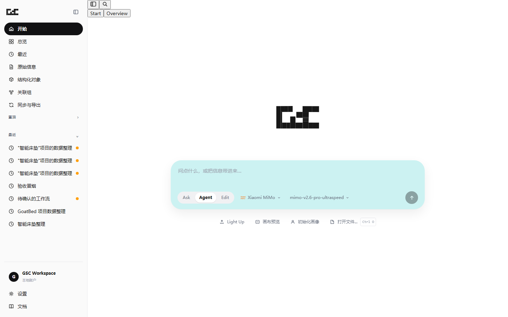
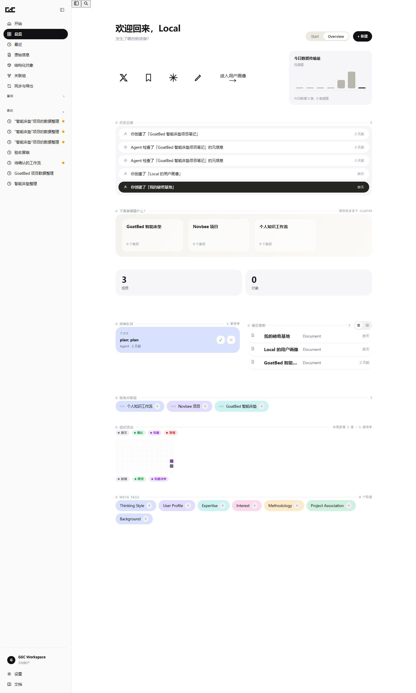
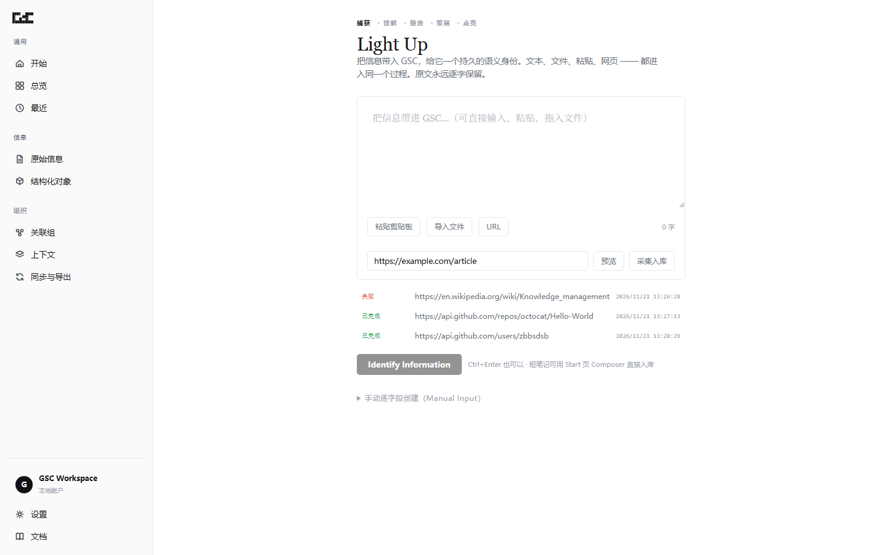
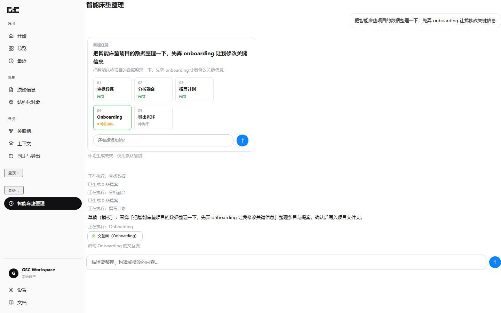
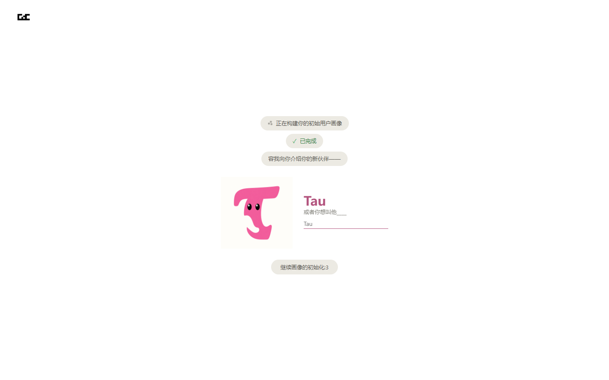

<p align="center">
  
</p>

<h1 align="center">GSC — Global Shared Context</h1>

<p align="center">
<b>Turns fragmented information into persistent, addressable, and reusable context.<br>
A local-first information infrastructure for human–AI collaboration.</b>
</p>

<p align="center">
  
  
</p>

---

## Why

Knowledge produced in AI sessions is scattered across chats, docs, repos, and workspaces — and dies with each session. GSC gives every piece of information a stable identity, explicit relationships, and a provenance trail, so humans and agents can build on what came before instead of rebuilding history.

GSC is **not** a note app, a vector database, or a wrapper around an agent runtime. It is an independent information layer: useful on its own, consumable by any agent.

## Core concepts (five, no more)

| Concept | One line |
|---|---|
| **Chunk** | The smallest information unit — a note, excerpt, or record — with a semantic name. Original text is always preserved. |
| **Cluster** | A topic-level group of related information ("project" is just one kind of cluster). |
| **Context** | An explicit-membership unit of context — a research topic, a decision domain. |
| **Meta Tag** | Three-level tagging (group → tag → typed parameters) that makes information understandable and discoverable. |
| **Proposal** | The safety model: every machine change lands as a pending proposal; a human accepts before it counts. Agents never write directly. |

## Quickstart

Requirements: **Node.js ≥ 22** (verified on v22.x) — no database setup needed out of the box (embedded PGlite).

```bash
npm install
npm run db:migrate     # applies all migrations to the embedded database
npm run api            # API server  → http://127.0.0.1:8788
npm run dev            # web UI      → http://localhost:5174
```

That's it — open `http://localhost:5174`, create an account, and **Light Up** your first piece of information.

| Command | What it does |
|---|---|
| `npm run api` | API server (default port `8788`, override with `PORT`) |
| `npm run dev` | Vite dev server (port `5174`, proxies `/api` to the API) |
| `npm run mcp` | MCP server over stdio for AI agents |
| `npm run worker` | Background worker (sync, scheduled capture) |
| `npm test` | Test suite (56 files, 257 tests passing) |
| `npm run api:check` | API smoke checks (requires the API process) |
| `npm run build` | Type-check + production build |

Optional configuration lives in `.env.local` (see `.env.example`): LLM provider for semantic naming, PostgreSQL adapter for deployment, secrets/CORS for production. Everything works without it.

## Capabilities

- **Light Up** — bring information in: direct text, files, paste, URLs. Web crawling and folder adapters included. Original text is preserved verbatim, forever.
- **Organize** — Chunks → Clusters → Contexts, with three-level Meta Tags and semantic naming proposals.
- **Collaborate with agents** — a conversation workspace where agents propose structured changes as reviewable task cards and UI flows; nothing lands without your confirmation.
- **Provenance & history** — every object carries source metadata and a modification trail. Ask "where did this come from?" and get an answer.
- **Overview** — a narrative activity feed, data transfer stats, and cluster workbench on one long page.

<div align="center">
  
  
  <br>
  
</div>

## For agents & developers

GSC speaks three integration dialects — pick one:

1. **MCP (recommended for agents)** — `npm run mcp` starts a stdio JSON-RPC server exposing 9 tools (`gsc_get_chunk`, `gsc_list_chunks`, `gsc_search`, `gsc_browse_clusters`, `gsc_get_cluster`, `gsc_browse_contexts`, `gsc_get_context`, `gsc_get_user_profile`, `gsc_propose`). Point your client at it with `GSC_API_URL` + `GSC_API_TOKEN` (a PAT from Settings → Connections).
2. **HTTP API + JS SDK** — thin zero-dependency client in [`sdk/`](sdk/README.md) over the frozen v1 contract ([`API_CONTRACT.md`](API_CONTRACT.md)).
3. **Push CLI & adapters** — `integrations/gsc-push.mjs` pipes session excerpts into GSC from Codex, opencode, WorkBuddy, or plain stdin:
   ```bash
   cat notes.md | node integrations/gsc-push.mjs --client workbuddy --project GSC --session manual-1
   ```

**Agents:** start with [`docs/agents/foragents.md`](docs/agents/foragents.md) (also served in-app at `/foragents`). Two iron rules: all machine changes go through proposals, and there are no exceptions.

## Repository layout

```text
GSC/
  README.md            you are here
  src/                 React app (views, chat workspace, Light Up, Overview)
  server/              node:http API, Drizzle schema, MCP server, ingest/sync pipelines
  sdk/                 zero-dependency JS client for the API
  integrations/        gsc-push CLI + Codex / opencode / WorkBuddy adapters
  scripts/             verification, screenshots, backup/restore utilities
  docs/
    images/            README screenshots
    agents/            agent onboarding (foragents)
  ui-prototype/        interactive static prototype + screenshot archive
  plans/               long-range product plans (internal)
  .env.example         all optional configuration, documented
```

## Documentation

| Document | What it answers |
|---|---|
| [`PRODUCT_VISION.md`](PRODUCT_VISION.md) | What GSC is building and why |
| [`INFORMATION_MODEL.md`](INFORMATION_MODEL.md) | The authoritative concept model |
| [`API_CONTRACT.md`](API_CONTRACT.md) | The frozen API v1 contract |
| [`docs/agents/foragents.md`](docs/agents/foragents.md) | How agents connect and behave |
| [`sdk/README.md`](sdk/README.md) | JS SDK usage |
| [`REMAINING_WORK.md`](REMAINING_WORK.md) | Current state and what's next |

## License

[GPL-3.0](LICENSE)
