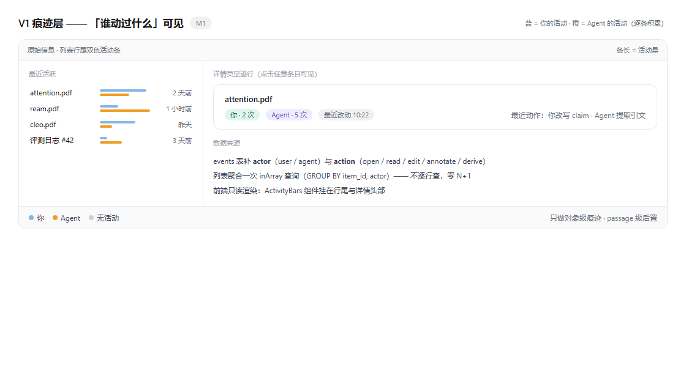
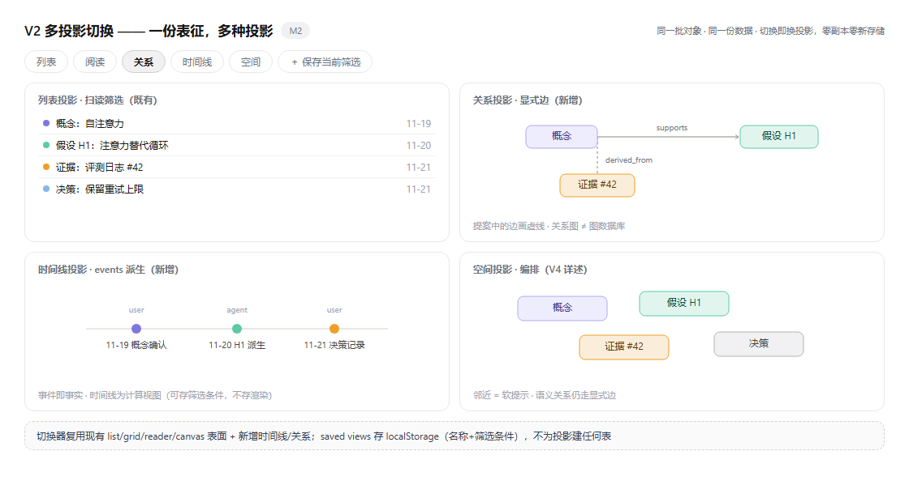
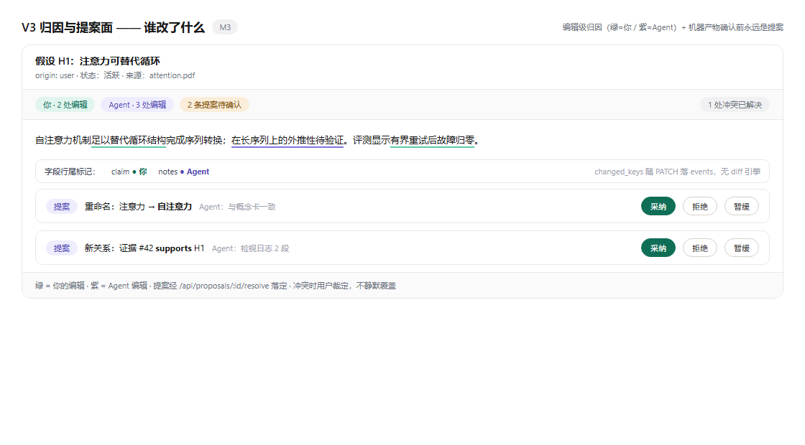
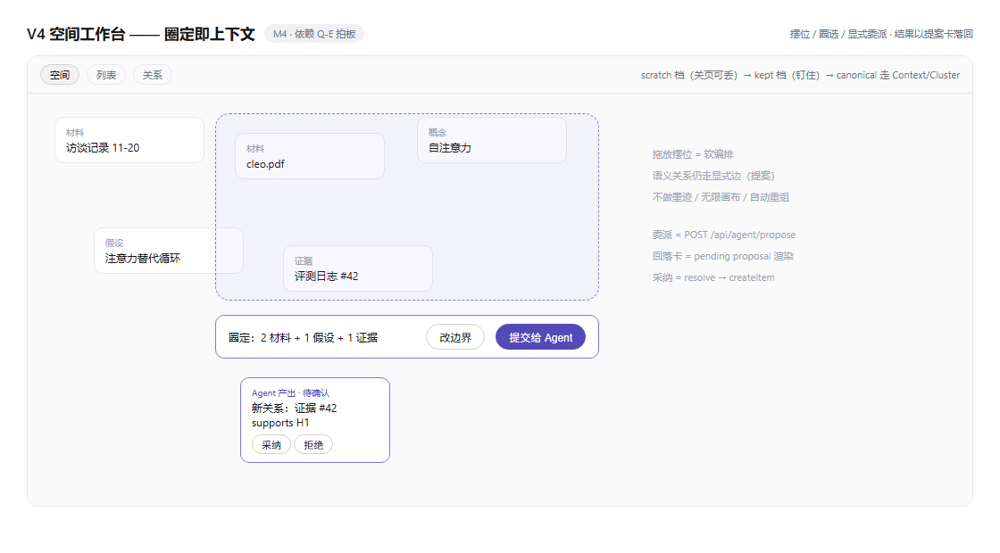
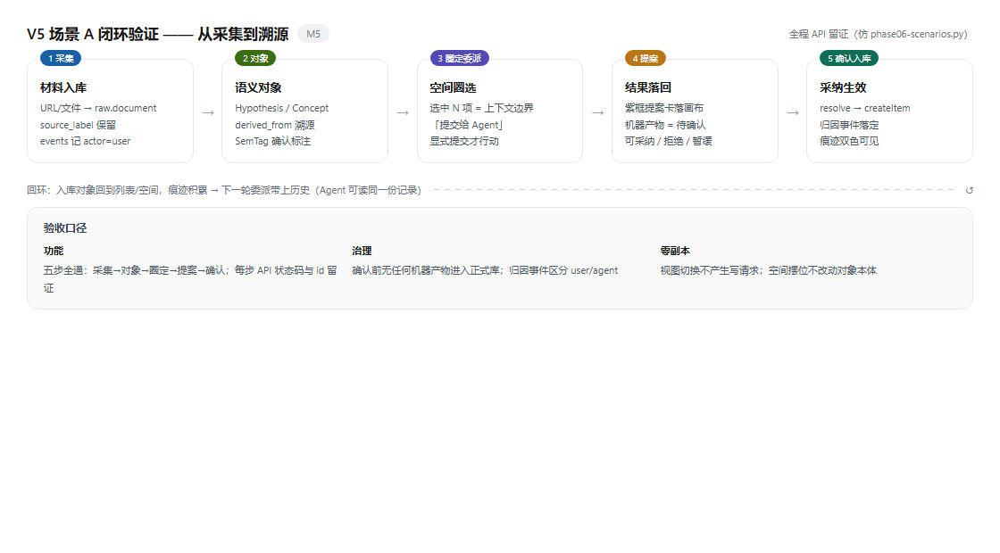

# GSC Phase 07 — 多视角工作台执行计划（扩充版）

> 状态：`PROPOSED`（待确认后开工）· 2026-11-22
> 依据：创始人决策 2026-11-22（GSC 多视角，Ream 感觉 + Huabu 感觉）· 研究集 `docs/research/malleable-context-space/` · `PHASE_07_PLAN.md` · 决策记录 D-088

---

## 一、背景与决策

GSC 已完成 P0–P6 与 P1/P2 全部执行项（vitest 135/135 全绿），核心信息模型（Raw/Object 混合模型、提案→确认制、关系表、溯源）稳定。Malleable Context Space 跨项目研究（五路论文：Ream / CLEO / IPI / Malleable Workspace / Inkitiate）给出方向：把「表征→就地操作→归因变更→互相看见→反思改结构」做成一套工作台基底。

创始人决策（DECIDED）：GSC 要包含**多种视角**，同时要有 **Ream 的感觉**（参与痕迹局部可视化、双向可读的互知意识）与 **Huabu 的感觉**（空间工作台：选择/圈定即上下文边界、显式委派）。View 是投影不是数据模型（D-079 纪律延续）；机器产物确认前永远是提案（D-042）。

本计划把该决策拆成五个可独立验收的垂直切片（V1–V5 / M1–M5）。

## 二、总体路线

V1 痕迹层 → V2 多投影切换 → V3 归因与提案面 → V4 空间工作台（依赖 Q-E 拍板）→ V5 场景闭环验证。V4 可与 V3 并行，其余串行。全程遵守：不为投影建表、不做向量/图数据库、不做无限画布、不做自动抽取与自动结构重组。

---

## 三、V1 痕迹层 —— 「谁动过什么」可见（M1）

### 3.1 目标（具体场面）

打开「原始信息」列表，每行右侧有一对蓝/橙横条：蓝=你的活动量、橙=Agent 的活动量。点进任一条目，详情页显示「你 2 次 · Agent 5 次 · 最近改动 10:22」，最近动作一句话可见。痕迹随使用逐条积累（Ream 的「计算磨损」感）。

### 3.2 技术路径

| 层 | 改动 | 位置 |
|---|---|---|
| DB | events 表补 `actor`（user/agent/system）与 `action`（open/read/edit/annotate/derive/propose）两列 | 新迁移 `0014_engagement.sql`，`server/persistence/schema.ts` |
| 写入 | detail GET 记 `open`（节流：同会话同 item 不重复）；PATCH 记 `edit`；agent/propose 成功记 `propose`(actor=agent) | `server/router.ts` 各 handler 内调 `recordEvent` |
| 聚合 | 新 `activityCountsByItem(db, ids)`：一次 `inArray` 查询 `GROUP BY item_id, actor`，返回 `{user, agent}` 计数 | `server/repo/events.ts` |
| API | 列表响应附 `activity: {user, agent}`；详情响应 events 已含 actor/action | `/api/items`、`/api/items/:id` |
| 前端 | `ActivityBars` 组件（双色条）挂列表行尾；详情头部足迹行 | `src/views/collections.tsx`、`detail.tsx`、`ui.tsx` |
| 性能 | 列表零 N+1（批量聚合一次查询）；open 事件节流写入 | — |

### 3.3 Layout 演示

### 3.4 验收

- vitest：events 读写 + 聚合查询正确（user/agent 分计）
- 手动：列表双色条 + 详情足迹行截图
- 边界：不做 passage 级、不做注意力推断、痕迹权限沿用 owner/share

---

## 四、V2 多投影切换 —— 一份表征，多种投影（M2）

### 4.1 目标（具体场面）

同一批对象在列表顶部一键换投影：列表（扫读）、阅读（原文）、关系（连线）、时间线（事件排布）、空间（编排）。切到时间线看到 11-19 概念确认 / 11-20 H1 派生……切到关系看到 supports / derived_from 连线。任何切换都不改动数据；常用筛选可「保存当前筛选」。

### 4.2 技术路径

| 层 | 改动 | 位置 |
|---|---|---|
| 前端 | 统一 `ViewSwitcher`（列表/阅读/关系/时间线/空间占位）；`TimelineView`（按 events 时间排布）；`RelationsView`（SVG 固定分层布局，不做力导向引擎） | `src/views/pages.tsx`、`collections.tsx`、新 `timeline.tsx`/`relations.tsx` |
| 数据 | 时间线消费列表级 events（新 `GET /api/events?item_ids=&since=` 只读端点）；关系消费既有 `/api/items/:id/relations` | `server/router.ts`、repo/events |
| 存储 | saved views 存 `localStorage.gsc.savedViews.v1`（名称+筛选条件 JSON）；**不为投影建任何表** | `src/lib/prefs.ts` 风格 |
| 样式 | 切换器与四格样式 | `views.module.css` |

### 4.3 Layout 演示

### 4.4 验收

- 测试：切换前后 API 数据快照一致；切换过程断言零写请求（spy fetch 无 POST/PATCH）
- 手动：五投影截图；保存筛选后刷新仍在
- 边界：关系图≠图数据库；时间线为计算视图

---

## 五、V3 归因与提案面 —— 谁改了什么（M3）

### 5.1 目标（具体场面）

详情页正文里你的改动画绿线、Agent 的画紫线；顶部归因条「你 2 处 · Agent 3 处 · 2 条提案待确认」；每行字段尾有小圆点标最后编辑者；页面下方两条紫色提案行（「重命名：注意力→自注意力」「新关系：证据#42 supports H1」）各带 采纳/拒绝/暂缓 按钮，点采纳即生效。

### 5.2 技术路径

| 层 | 改动 | 位置 |
|---|---|---|
| DB/事件 | PATCH 时 `recordEvent(action='edit', actor, changed_keys=[...])`（取 PATCH body 的字段名；V1 的 actor 字段直接复用） | `server/router.ts` PATCH handler |
| 归因数据 | `attributionByItem(db, id)`：从 events 聚合 user/agent 编辑数 + 每字段最后编辑者 | `server/repo/events.ts` |
| API | 详情响应附 `attribution: {user_edits, agent_edits, field_owners: {...}, conflicts_resolved}` | `/api/items/:id` |
| 前端 | 归因条（绿/紫计数 chip）；字段行尾编辑者圆点；**内嵌提案行**：拉 `GET /api/proposals?item_id=` 渲染在详情内，按钮直连 `/api/proposals/:id/resolve` | `detail.tsx`、`SemTag.tsx` |
| 后置 | 正文逐字下划线（diff 渲染）、意图自动推断（CLEO 推断模块）、冲突合并 UI | DEFERRED |

### 5.3 Layout 演示

### 5.4 验收

- vitest：PATCH 落 actor+changed_keys；提案 resolve 后状态与入库正确
- 手动：归因条+提案行截图（对齐演示图）
- 治理：确认前机器产物不进正式库（D-042 回归）

---

## 六、V4 空间工作台 —— 圈定即上下文（M4，⚠️ 依赖 Q-E 拍板）

### 6.1 目标（具体场面）

空间视图里拖 5 张卡自由摆位；鼠标拉矩形圈选 3 张，虚线光晕即上下文边界；底部条「圈定：3 材料 → 提交给 Agent」。Agent 结果以紫框提案卡（待确认）落到你指示的空位；点「采纳」才进库。摆位只是软编排，语义关系仍走显式边。

### 6.2 技术路径

| 层 | 改动 | 位置 |
|---|---|---|
| 前端 | 新 `views/spatial.tsx`：DOM+transform 绝对定位卡片（非 WebGL、非无限画布，视口滚动即可）；拖放摆位；矩形圈选；底部上下文条 | `src/views/spatial.tsx` |
| 表征存储 | scratch 档：`localStorage.gsc.spatial.v1`（item_id→{x,y}）；kept 档（Q-E 拍板后）：新表 `spatial_layouts(item_id, x, y, owner_id)`——逐行存坐标，**不用 JSONB 大包** | `src/lib/prefs.ts` / 新迁移 |
| 委派 | 「提交给 Agent」→ `POST /api/agent/propose`（复用现有 LLM propose 链路），scope=圈选集合 | 既有 API |
| 回落 | pending proposals 渲染为紫框卡（落点=用户指示位置或自动排布）；采纳=resolve→createItem；卡片即消失为正式条目 | `detail.tsx` 提案行同款逻辑 |
| 后置 | 墨迹（ink）、自动结构重组、拖拽语义化（邻近→关系仅提案） | DEFERRED |

### 6.3 Layout 演示

### 6.4 验收

- 端到端：摆位→圈选→委派→提案卡回落→采纳入库（场景 A 前半）
- 边界：摆位不改对象本体（零副本断言）；不做无限画布
- ⚠️ 开工前确认 Q-E：建议 scratch/kept 两档先行

---

## 七、V5 场景 A 闭环验证（M5）

### 7.1 目标

研究场景 A 全流程留证：采集→对象→圈定委派→提案→确认→溯源可查，每步 API 状态码与 id 记录在案，写入 `MVP_EVALUATION.md` 附录。

### 7.2 技术路径

- `scripts/phase07-scenario-a.py`（仿 `phase06-scenarios.py`）：API 级五步留证 + 归因事件校验 + 零副本断言（切换视图无写）
- 手动腿：空间视图圈选→委派→采纳（UI 截图归档）

### 7.3 Layout 演示

### 7.4 验收口径

- 功能：五步全通、id 留证
- 治理：确认前无机器产物入库；归因区分 user/agent
- 零副本：视图切换零写请求；摆位不改本体

---

## 八、不做清单（全程有效）

1. 不为视图/投影建存储表；空间邻近≠语义关系（显式边为准）。
2. 不做向量库、图数据库、无限画布、自动抽取、自动结构重组。
3. 机器产物永远提案（D-042）；痕迹权限沿用 owner/share（GAP-15 不在本期）。
4. 过程模型（P/W/O/E/R）、passage 级痕迹、墨迹、跨项目协议 → 后续阶段。

## 九、执行前确认点

1. **Q-E 档位**：表征分 scratch/kept 两档先行（canonical 照旧走 Context/Cluster）——同意？
2. **顺序**：V1→V2→V3→V4（V4 可与 V3 并行）——同意？
3. **验收**：逐里程碑（M1–M5）验收 vs 完成后一次验收？

## 十、里程碑总表

| 里程碑 | 交付 | 验证 |
|---|---|---|
| M1 | events actor/action + 双色活动条 + 足迹行 | vitest + 截图 |
| M2 | ViewSwitcher + 时间线/关系投影 + saved views | 零副本断言 + 截图 |
| M3 | 归因事件 + 归因条 + 内嵌提案行 | 提案流测试 + 截图 |
| M4 | 空间视图 + 圈选委派 + 提案卡回落 | 端到端 + 零副本断言 |
| M5 | 场景 A 留证脚本 + MVP_EVALUATION 附录 | 全流程 id 留证 |
